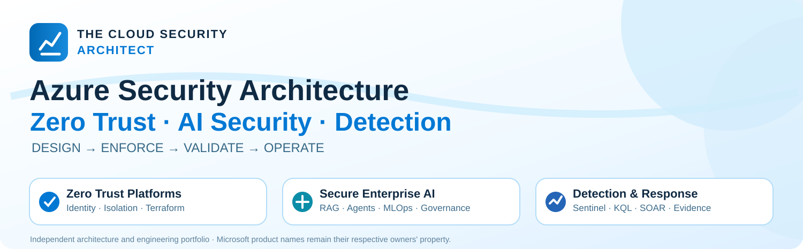

  

# Cloud Security Architect | Azure · Zero Trust · AI Security · SIEM/XDR

I design secure cloud and AI architectures, with an emphasis on **how controls are selected, implemented, tested, and operated**.

**Identity → Platform → Workloads → Data & AI → Detection → Governance**

[LinkedIn](https://www.linkedin.com/in/mariohartson) · [Website](https://mhartson.com) · [Flagship work](#featured-architecture-and-security-engineering) · [Implementation companion](#hands-on-implementation-and-other-engineering)

## Featured architecture and security engineering

<table>
<tr>
<td width="33%" valign="top">

### 01 · [Azure Zero Trust Architectures](https://github.com/mhartson310/Azure-Zero-Trust-Reference-Architectures)

**Secure enterprise cloud platforms**

Identity · Privileged access · Private connectivity · Terraform · Monitoring

[Architecture patterns](https://github.com/mhartson310/Azure-Zero-Trust-Reference-Architectures/tree/main/architecture/enterprise-application) · [Terraform](https://github.com/mhartson310/Azure-Zero-Trust-Reference-Architectures/tree/main/terraform/enterprise-application) · [Validation plan](https://github.com/mhartson310/Azure-Zero-Trust-Reference-Architectures/blob/main/docs/validation/zero-trust-end-to-end-runbook.md)

</td>
<td width="33%" valign="top">

### 02 · [Azure AI Security Architectures](https://github.com/mhartson310/Azure-AI-Security-Reference-Architectures)

**Secure emerging AI workloads**

Enterprise RAG · Agentic AI · Governed MLOps · AI FinOps

[Explore architecture gallery](https://github.com/mhartson310/Azure-AI-Security-Reference-Architectures#architecture-library) · [Secure RAG V2](https://github.com/mhartson310/Azure-AI-Security-Reference-Architectures/tree/main/01-secure-enterprise-rag) · [Threat models](https://github.com/mhartson310/Azure-AI-Security-Reference-Architectures/tree/main/02-secure-agentic-ai/threat-model)

</td>
<td width="33%" valign="top">

### 03 · [Sentinel KQL Library](https://github.com/mhartson310/Sentinel-KQL-Library)

**Operational detection and response**

KQL analytics · Defender XDR · Bicep · SOAR · Response gates

[Detection library](https://github.com/mhartson310/Sentinel-KQL-Library/tree/main/kql-queries) · [Analytics-as-code](https://github.com/mhartson310/Sentinel-KQL-Library/tree/main/deploy/bicep/zero-trust-analytics) · [Response playbooks](https://github.com/mhartson310/Sentinel-KQL-Library/tree/main/deploy/playbooks/zero-trust)

</td>
</tr>
</table>

### How I approach architecture decisions

**Business problem → Architecture and trust boundaries → Threats → Control ownership → Implementation → Negative tests → Telemetry and evidence**

The [Zero Trust architecture decision framework](https://github.com/mhartson310/Azure-Zero-Trust-Reference-Architectures/tree/main/docs/decision-framework/architecture-decision-framework) documents tradeoffs, rejected approaches, risk, cost and validation gates. Each architecture separates *design intent* from *observed proof*.

## Hands-on implementation and other engineering

| Repository | Role in the portfolio | Where to start |
|---|---|---|
| [Secure Enterprise RAG — implementation companion](https://github.com/mhartson310/Azure-Secure-Enterprise-RAG) | **Code and deployment path:** FastAPI, Bicep, ACL-aware retrieval, Sentinel/KQL and security tests. The [AI architecture library](https://github.com/mhartson310/Azure-AI-Security-Reference-Architectures/tree/main/01-secure-enterprise-rag) owns the broader design blueprint. | [App](https://github.com/mhartson310/Azure-Secure-Enterprise-RAG/tree/main/app) · [Deployment](https://github.com/mhartson310/Azure-Secure-Enterprise-RAG/tree/main/deploy) · [Tests & CI](https://github.com/mhartson310/Azure-Secure-Enterprise-RAG/actions) |
| [FedRAMP Azure Toolkit](https://github.com/mhartson310/FedRAMP-Azure-Toolkit) | Selected compliance-as-code patterns for account lifecycle and audit evidence; not an authorization package. | [Control automation](https://github.com/mhartson310/FedRAMP-Azure-Toolkit/tree/main/control-automation) |
| [Azure Landing Zones](https://github.com/mhartson310/Azure-Landing-Zones) | Terraform-based hub/spoke networking and landing-zone design. | [Terraform modules](https://github.com/mhartson310/Azure-Landing-Zones/tree/main/terraform) |
| [Azure Cost Optimization Toolkit](https://github.com/mhartson310/Azure-Cost-Optimization-Toolkit) | FinOps investigation scripts and reviewable optimization decisions. | [Tooling](https://github.com/mhartson310/Azure-Cost-Optimization-Toolkit/tree/main/scripts) |

### Evidence maturity — what the projects do and do not prove

| Evidence type | Current meaning |
|---|---|
| **Architecture, diagrams, ADRs, and threat models** | Documented decisions and hypotheses, *not* deployed control effectiveness |
| **Infrastructure and application code** | Inspectable implementation patterns, *not* automatically a successful Azure deployment |
| **Automated CI checks** | Actual pass/fail is visible in each repo's [Actions](https://github.com/mhartson310?tab=repositories); a workflow file or badge is not itself evidence |
| **Azure lab / production validation** | Only claimed when reproducible results and sanitized evidence are published |

**Current focus:** Repair failing CI where necessary, run the AI architecture tests in CI, and produce one reproducible Azure negative-security lab with redacted authorization evidence.

## Focus areas

**Architecture:** Azure security, Zero Trust, Entra ID, Managed Identity, Private Link, landing zones, governance, FedRAMP patterns.  
**Secure AI:** Enterprise RAG, Microsoft Foundry, Copilot Studio, Azure Machine Learning, Purview, threat modeling, MITRE ATLAS.  
**Operations:** Microsoft Sentinel, Defender XDR, KQL, detection-as-code, incident response, SOAR, FinOps.

## Connect

Interested in secure cloud and AI architecture, platform modernization, detection engineering, or design collaboration?

[Connect on LinkedIn](https://www.linkedin.com/in/mariohartson) · [Visit my website](https://mhartson.com)

Independent professional portfolio. Reference content is not official Microsoft guidance; validation state is documented per project.
